# Architecture

```mermaid
flowchart LR
  A[Isolated browser workspace] --> B[Validate watchlist and thresholds]
  B --> C[Verify chain 1672 and finalized head]
  C --> D[Fetch bounded ERC-20 Transfer logs]
  D --> E[Normalize with token decimals]
  E --> F[Deduplicate chain + tx + log]
  F --> G[Classify group direction]
  G --> H[Evaluate exact threshold]
  H --> I[(D1 durable state)]
  I --> J[Unified report and JSON/CSV exports]
```

The browser owns an opaque workspace ID stored locally. Every API request is scoped to that ID, so one public visitor cannot overwrite another visitor's configuration. D1 persists configuration, the confirmed cursor, deduplicated observations, monitor state and reports.

A conditional D1 scan lock prevents overlapping scans. The cursor is updated only in the same D1 batch that stores a successful report. Failed reads release the lock, record the error and retain the previous cursor.

Production scans use Pharos Pacific JSON-RPC because a deployed Worker is not an interactive MCP agent runtime. Official Chain MCP was used for capability discovery and real evidence capture; the UI and reports distinguish those transports.
